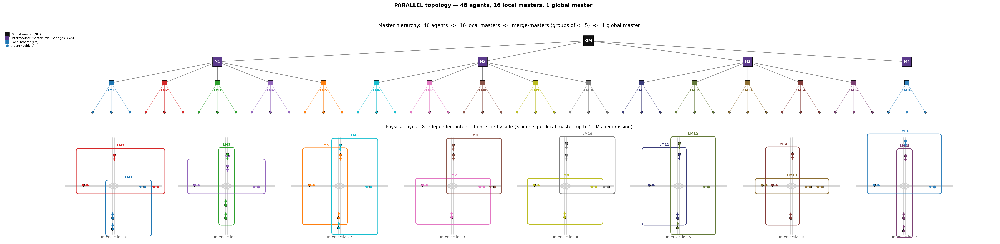
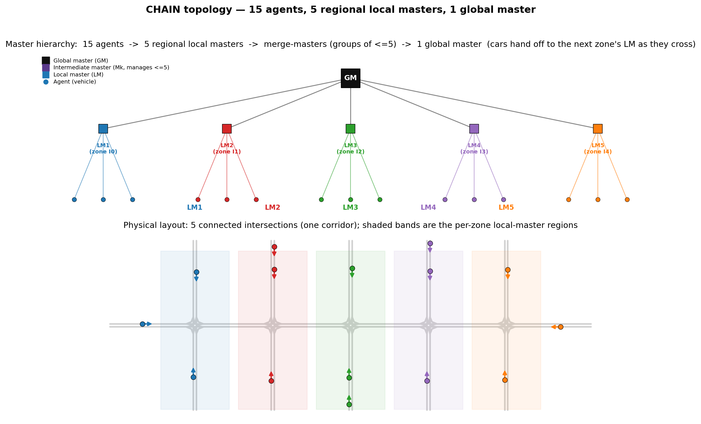

# Hierarchical Multi-Agent RL — Scalable Coordinated Driving

one pair of trained models (master + agent), deployed at any scale from 3 to 48 agents across independent or connected intersections, consistently reduces crash rates compared to running agents without a master signal.

## Architecture

```
                         GM  (Global Master)
                        / | \
                      M1  M2  ...   (intermediate masters when N_LMs > 5)
                     /|   |\
                   LM1  LM2  ...   (Local Masters — one per intersection zone)
                   /|\   /|\
                 a  a  a  a  a  a  (Agents — one per vehicle)
```

**Master observation (25-D):** 5 slots × 5 values each.
Each slot = `[v0, v1, v2, v3, type_bit]`:
- `v0..v3` is either a subordinate agent's 4-D kinematic state or a subordinate master's 4-D embedding.
- `type_bit = 0.0` marks a raw agent state slot; `type_bit = 1.0` marks a master embedding slot.

This identifier bit is what lets the same master model manage either agents or other masters without any architectural change. Empty slots are zero-padded.

**Master output:** a 4-D embedding vector, passed down to all subordinates.

**Agent observation (8-D):** 4-D local kinematic state + 4-D LM embedding received from the master above.

**Agent action:** binary — `{slow, fast}` — mapped to fixed throttle values.

## Topologies evaluated

**Parallel** — each intersection is an independent environment, managed by one Local Master. Agents never cross intersection boundaries. The hierarchy grows by adding more (LM, intersection) pairs.



**Chain** — intersections are physically connected in a road corridor. Agents route across multiple zones; the LM responsible for a zone receives and hands off agents dynamically as they enter or leave.




